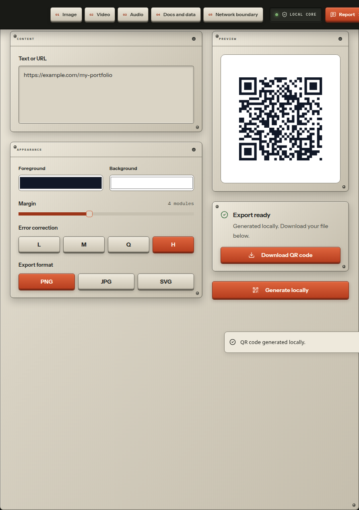
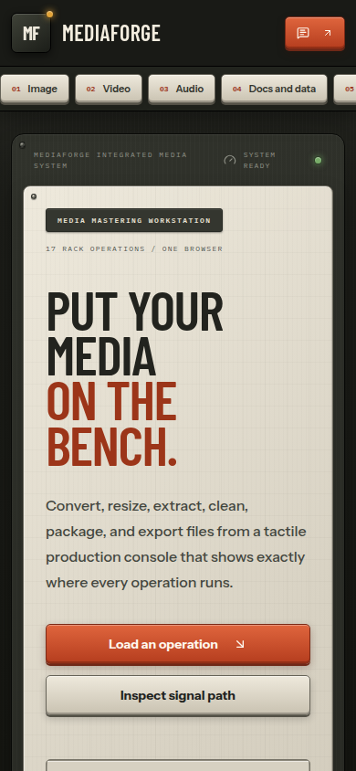

<div align="center">

`MF / LOCAL MEDIA WORKBENCH`

# MediaForge

### Put your media on the bench.

A private workspace for the small file jobs that interrupt your day.<br>
Convert an image, organize a PDF, cut a sound, or build a favicon.<br>
**Selected files stay on your device for core processing.**

[Get started](#run-it-locally) · [Tools](#one-workbench-five-benches) · [Desktop candidates](#desktop-release-status) · [Documentation](docs/development.md) · [Report a problem](https://github.com/Gurtejhundal/MediaForge/issues)


</div>

MediaForge is for creators, students, and developers who need useful media operations without handing every source file to a conversion service. It runs as a web application and now includes desktop packaging. No account is required. Core tools work through browser file APIs, Canvas, Web Audio, document libraries, workers, and local Blob downloads.

## One workbench. Five benches.

| Bench | Actual capabilities |
| --- | --- |
| **Images** | Resize, crop, rotate, caption, watermark, compress and convert; detail upscale; model-based background removal; favicon ZIPs. |
| **Video** | Sample frames into a ZIP, export muted WebM, upscale, and soften a selected region. |
| **Audio** | WAV conversion, soundtrack extraction, trimming, merging, normalization, volume, reverse and speed. |
| **Documents & data** | PDF organization/editing, text-oriented Office conversions, OCR, JSON/CSV/XML/YAML conversion, Markdown/HTML/TXT exports and QR generation. |
| **Network** | Direct public media downloads; optional owner-configured platform-download provider; text-only feedback. These routes contact servers. |

**The boundary is visible.** Green local paths process selected files in this session. Model/OCR tools may download runtime assets on first use. Network tools are marked separately. MediaForge does not automatically share your URLs with random public download services.

## From content to a QR you can keep


*Actual production-build captures using synthetic content; waiting time is shortened. This is a working workflow, not a mockup.*

<details>
<summary>See the real QR workspace and mobile view</summary>





</details>

## Run it locally

Use **Node 24.12+ in the 24.x line** and npm. Clone the repository to run the current source:

```sh
git clone https://github.com/Gurtejhundal/MediaForge.git
cd MediaForge
npm ci
npm run dev
```

Open **http://127.0.0.1:3000**. For a production preview, run `npm run build` then `npm start`. See [configuration, development and troubleshooting](docs/development.md).

## Desktop release status

**0.2.0 is a local release candidate. No public installer release has been published.**

| Target | Candidate format | Verification |
| --- | --- | --- |
| Linux x64 | AppImage, deb | Unpacked, deb-extracted and AppImage-extracted payloads passed native launch/export/restart checks; see [limits](docs/audit.md). |
| Windows x64 | Per-user installer | Build workflow configured; native execution pending. |
| macOS Apple Silicon | dmg, zip | Build workflow configured; native execution pending. |
| macOS Intel | dmg, zip | Build workflow configured; native execution pending. |

Build locally with `npm run desktop:dist`. The [release procedure](docs/releasing.md) explains checksums, installation, native verification, signing and publication. There is no auto-update service. Public publication is pending the owner's license/distribution decision; no project license has been chosen on their behalf.

## Keep the limits visible

- **Save your output.** Inputs, previews and drafts live in memory. Refreshing or quitting discards them. Downloads are ordinary files you control; only activity counters and the last output filename/time persist locally. [Storage and backups](docs/architecture.md#storage-and-backups).
- **Codec support varies.** Canvas video output is WebM without audio. Audio exports are WAV. AVIF encoding and input formats depend on the browser. SVG image exports embed a raster image; they do not vectorize artwork.
- **Documents have fidelity limits.** Office-to-PDF rebuilds readable text; PDF-to-Office recovery is best-effort. Secure redaction, PDF encryption and archival PDF/A are deliberately unavailable. A drawn signature is not a certificate.
- **First-use models need a network.** Background removal and OCR fetch model/runtime assets. They are not guaranteed to work offline on first launch. Device memory limits large jobs; frame ZIPs stop at 1,800 frames.
- **Network delivery is optional.** Without a configured webhook, feedback stays in the form for retry or a GitHub issue draft. Platform downloads need a configured provider. Direct media downloads are capped at 50 MB.

## Under the faceplate

[Architecture & privacy](docs/architecture.md) · [Audit & verification](docs/audit.md) · [Dependency review](docs/dependencies.md) · [Release notes](docs/releases/0.2.0.md) · [Contributing](CONTRIBUTING.md) · [Security](SECURITY.md)

<details>
<summary>Checks before changing the workbench</summary>

```sh
npm run lint
npm run typecheck
npm test
npm run audit:dependencies
npm run build
npx playwright install --with-deps chromium
npm run test:e2e
```

Desktop changes also need a packaged-app smoke test on each affected platform. The dependency gate prints the current, exact-version background-removal exception rather than claiming a clean audit. Native CI artifacts are uploaded only after the packaged executable passes. [Full procedure](docs/releasing.md).

</details>

---

<div align="center">

### Keep the forge caffeinated ☕

The pixels stay local. The coffee is optional.<br>
If MediaForge saved your afternoon, you can put a little fuel in the next one.


**Scan with your UPI app · any amount, zero pressure.**<br>
The workbench works just as well without a tip.

<sub>Existing owner-supplied QR reused with permission. No payment details were invented.</sub>

</div>
