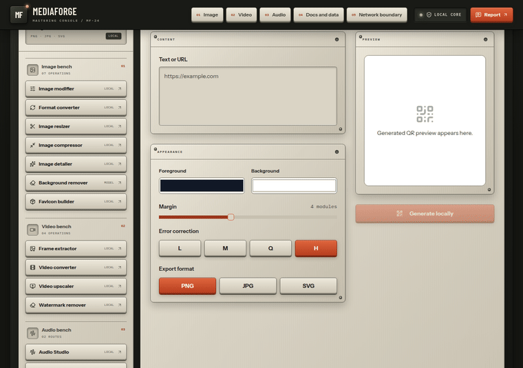
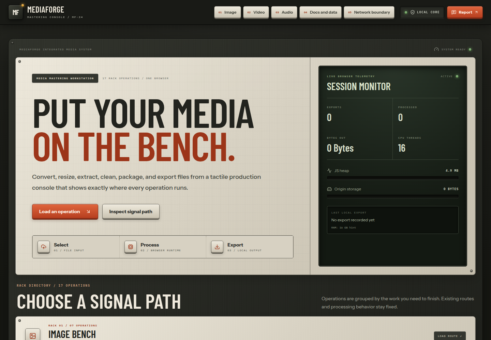
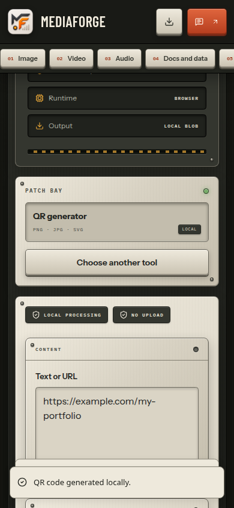

<div align="center">

`MF / LOCAL MEDIA WORKBENCH`

# MediaForge

### Put your media on the bench.

Resize an image. Organize a PDF. Cut a sound. Make a QR code.<br>
**One workbench for the small file jobs that interrupt your day.**

[**Open MediaForge ↗**](https://mediaforge-tau.vercel.app/) &nbsp; · &nbsp; [**↓ Get the app**](#get-the-app) &nbsp; · &nbsp; [See it in action](#see-it-in-action) &nbsp; · &nbsp; [Run from source](#run-from-source) &nbsp; · &nbsp; [Coffee ☕](#keep-the-forge-caffeinated)

`Web · Windows · macOS · Linux` &nbsp; `No account` &nbsp; `Core processing stays on your device`

</div>

---

## Get the app

**The first 0.2.0 release is being built and verified.** Desktop links below open the release list until publication completes.

**[MediaForge 0.2.0](https://github.com/Gurtejhundal/MediaForge/releases)** · Choose your workbench. Keep your files.

<table>
  <tr>
    <td width="50%" valign="top">
      <h3> &nbsp; Web</h3>
      <p>A quick file job, without installing anything.</p>
      <p><a href="https://mediaforge-tau.vercel.app/"><b>Open MediaForge ↗</b></a></p>
      <sub>No sign-in · Desktop and mobile layouts</sub>
    </td>
    <td width="50%" valign="top">
      <h3> &nbsp; Windows</h3>
      <p>Your media workbench, ready from the desktop.</p>
      <p><a href="https://github.com/Gurtejhundal/MediaForge/releases"><b>↓ Intel / AMD</b></a></p>
      <sub>64-bit · Per-user installer · Unsigned</sub>
    </td>
  </tr>
  <tr>
    <td width="50%" valign="top">
      <h3> &nbsp; macOS</h3>
      <p>A little room on your Mac for the next file job.</p>
      <p><a href="https://github.com/Gurtejhundal/MediaForge/releases"><b>↓ Apple Silicon</b></a> &nbsp; · &nbsp; <a href="https://github.com/Gurtejhundal/MediaForge/releases"><b>↓ Intel</b></a></p>
      <sub>DMG installers · Unsigned, not notarized</sub>
    </td>
    <td width="50%" valign="top">
      <h3> &nbsp; Linux</h3>
      <p>Local tools. Ordinary files. Your desktop.</p>
      <p><a href="https://github.com/Gurtejhundal/MediaForge/releases"><b>↓ AppImage</b></a> &nbsp; · &nbsp; <a href="https://github.com/Gurtejhundal/MediaForge/releases"><b>↓ DEB</b></a></p>
      <sub>64-bit Intel / AMD · Ubuntu 24.04 native CI</sub>
    </td>
  </tr>
</table>

[All releases](https://github.com/Gurtejhundal/MediaForge/releases) &nbsp; · &nbsp; [Checksums](https://github.com/Gurtejhundal/MediaForge/releases) &nbsp; · &nbsp; [Matching source](https://github.com/Gurtejhundal/MediaForge/releases)

<details>
<summary>Installation help &amp; release details</summary>

- **Windows:** open the setup file and choose an installation folder. This release provides x64, not a native ARM64 build.
- **macOS:** choose the DMG for your processor, open it, and drag MediaForge into Applications. Prefer a ZIP? [Apple Silicon](https://github.com/Gurtejhundal/MediaForge/releases) · [Intel](https://github.com/Gurtejhundal/MediaForge/releases).
- **Linux:** install the DEB with your package manager, or allow execution of the AppImage and open it. AppImage requires FUSE 2 and a compatible sandbox/user-namespace setup. If those are unavailable, prefer the DEB; keep the Chromium sandbox enabled. Linux ARM builds are not provided.

Windows and Mac downloads are **unsigned**; macOS builds are **not notarized**. Your OS may ask you to approve the app. Review the source and checksum before approving an unsigned download. No automatic updater is included.

All four targets run source, browser and packaged-app launch/export/restart checks in native CI. These checks do not certify every OS version or exercise privileged installer execution and AppImage FUSE mounting. [Verification and installation limits](docs/hosted-verification.md) · [Release notes](docs/releases/0.2.0.md).

Published downloads will be public GitHub release assets and will not require GitHub sign-in. Model/OCR assets may need a network on first use. Save inputs and exports separately; conversion drafts are memory-only.

</details>

## See it in action

<picture>
  <source media="(prefers-reduced-motion: reduce)" srcset="docs/readme/qr-workspace.png">
  
</picture>

<sub>Real production-build captures with sample content. The GIF shortens waiting time; it shows the working app.</sub>

<details>
<summary>Explore the workbench and mobile view</summary>





[Capture provenance and regeneration](docs/readme/README.md)

</details>

## One workbench. Five benches.

| Bring… | Take away… |
| --- | --- |
| **An image** | Resized, cropped, rotated, captioned, compressed or converted files; favicon ZIPs; model-based background removal. |
| **A video** | Extracted image frames, a muted WebM, an upscaled clip or a softened region. |
| **A sound** | WAV exports, a trimmed ringtone, merged clips, normalized volume, reverse or speed changes. |
| **Documents & data** | Organized PDFs, text-oriented Office conversions, OCR, JSON/CSV/XML/YAML conversions, Markdown/HTML/TXT and QR codes. |
| **A public media URL** | A direct download with bounded server fetching; platform downloads require an owner-configured provider. |

**Selected files stay on your device for core processing.** Green local paths use browser file APIs, Canvas, Web Audio and local libraries. Model/OCR tools may download assets. URL downloads and optional text feedback use clearly marked network routes.

<details>
<summary>A few practical limits</summary>

- **Save your output.** Refreshing or quitting discards input files, previews and drafts. Only activity counters and the last export's filename/time persist locally. Downloads remain ordinary files you control. [Storage and backups](docs/architecture.md#storage-and-backups).
- **Formats depend on the browser.** Video exports are muted WebM; audio exports are WAV. Input codecs and optional image encoders vary. SVG image exports embed raster artwork rather than vectorizing it.
- **Document layout is best-effort.** Office/PDF conversions prioritize readable content. Secure redaction, PDF encryption, archival PDF/A and cryptographic signatures are not included.
- **First-use models need a network.** Background removal and OCR fetch runtime/model assets. Frame ZIPs stop at 1,800 frames; large jobs depend on device memory.
- **Network tools need configuration.** Platform download providers and feedback webhooks are optional. Failed feedback stays in the form. Direct media downloads are capped at 50 MB.

</details>

## Run from source

Use **Node.js 24.12+ in the 24.x line** and npm:

```sh
git clone https://github.com/Gurtejhundal/MediaForge.git
cd MediaForge
npm ci
npm run dev
```

Open **http://127.0.0.1:3000**. Build a production preview with `npm run build` then `npm start`; build a desktop installer for your current OS with `npm run desktop:dist`.

| Need the details? | Start here |
| --- | --- |
| Configuration, development, tests and troubleshooting | [Development guide](docs/development.md) |
| Architecture, privacy, storage and backups | [How the workbench works](docs/architecture.md) |
| Versions, packaging, source and checksums | [Release guide](docs/releasing.md) |
| Findings and observed checks | [Audit](docs/audit.md) · [Hosted verification](docs/hosted-verification.md) |
| Licensing and dependencies | [AGPL-3.0](LICENSE) · [Third-party notices](THIRD_PARTY_NOTICES.md) · [Dependency review](docs/dependencies.md) |

[Contribute](CONTRIBUTING.md) · [Report a problem](https://github.com/Gurtejhundal/MediaForge/issues) · [Security](SECURITY.md)

## Keep the forge caffeinated

The pixels stay local. The coffee is optional. ☕<br>
If MediaForge saved your afternoon, you can put a little fuel in the next one.

<p align="center">
  <a href="docs/readme/upi-qr.png"></a><br>
  <b>Scan with your UPI app · any amount, zero pressure.</b><br>
  <sub>The workbench works just as well without a tip.</sub>
</p>

---

<p align="center"><b>MediaForge</b> — keep the file. Use the console.<br><sub>Made by <a href="https://github.com/Gurtejhundal">Gurtejbir Singh</a> · AGPL-3.0 · no warranty</sub></p>
