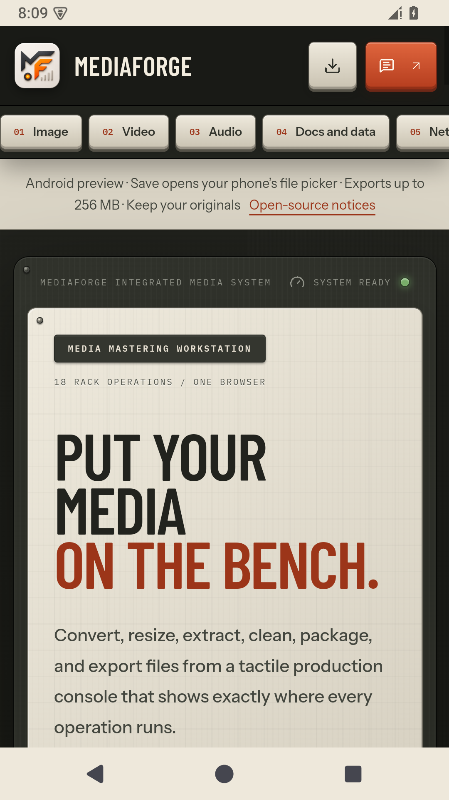
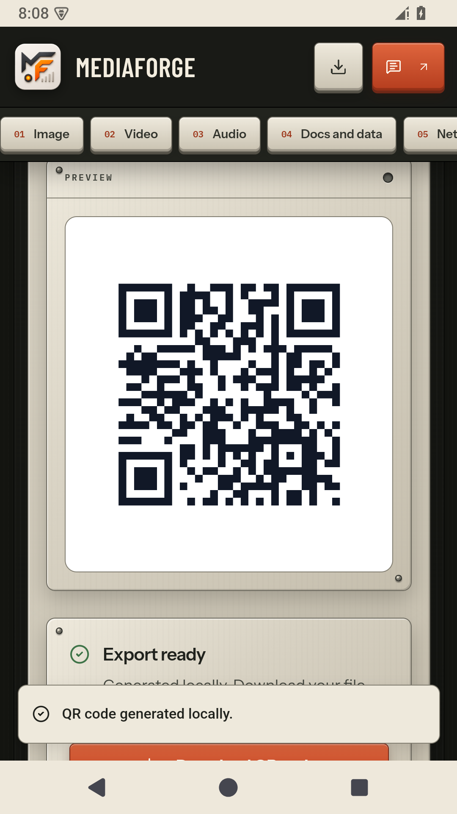
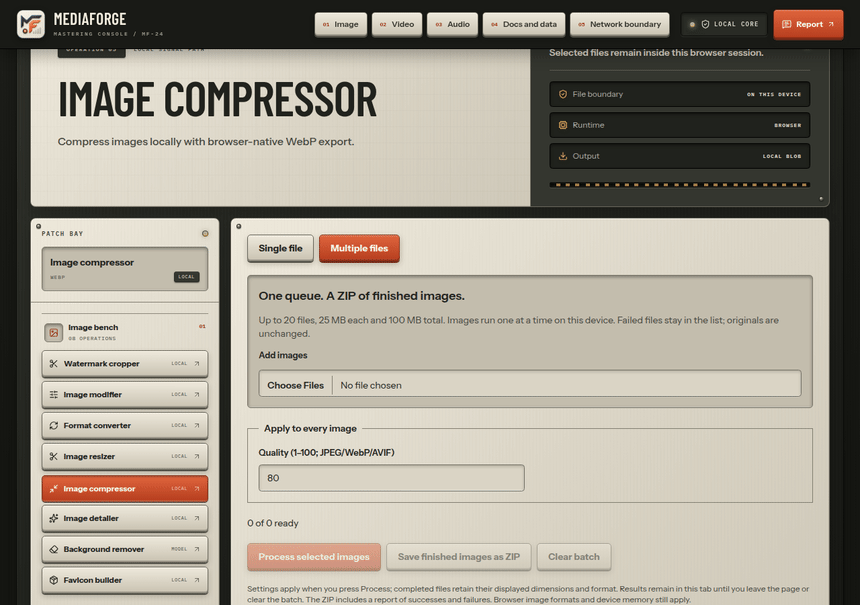
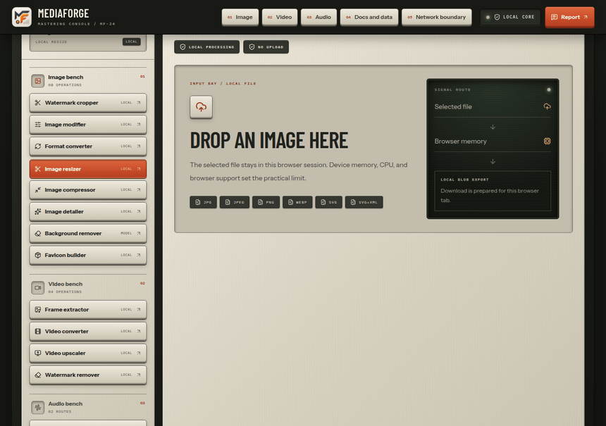
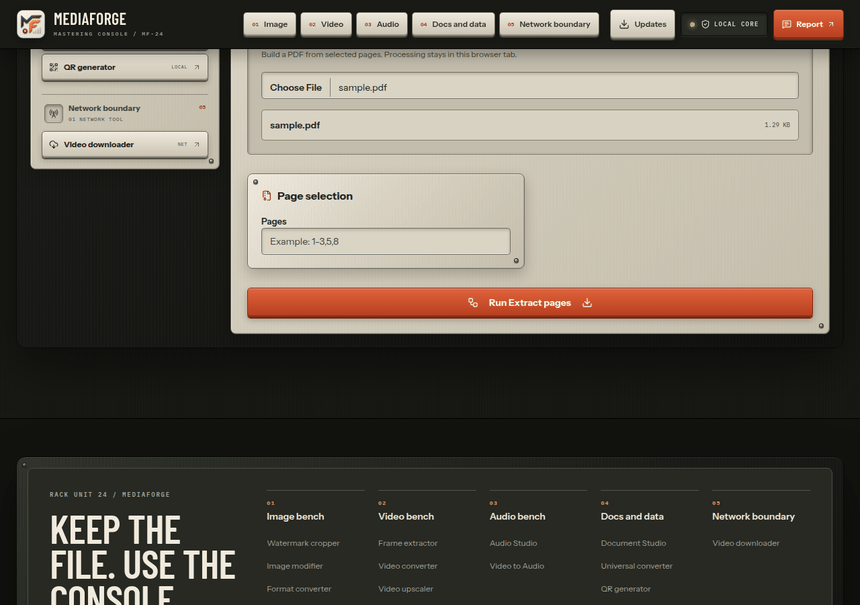
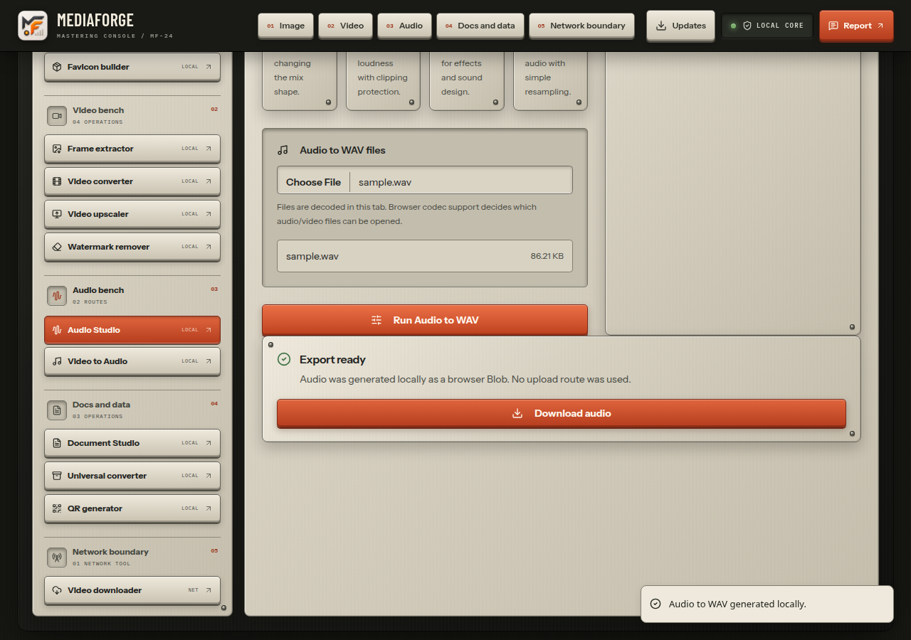
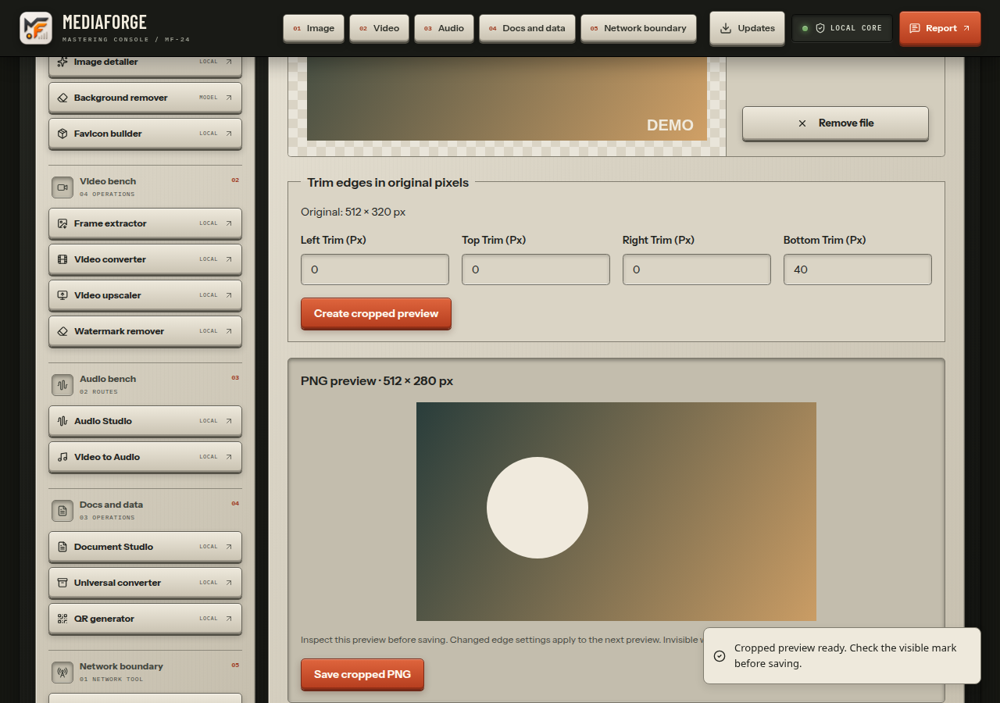

<div align="center">


`MF / LOCAL MEDIA WORKBENCH`

# MediaForge

### Put your media on the bench.

Resize an image. Organize a PDF. Cut a sound. Make a QR code.<br>
**One workbench for the small file jobs that interrupt your day.**

[**Open MediaForge ↗**](https://mediaforge-tau.vercel.app/) &nbsp; · &nbsp; [**↓ Get the app**](#get-the-app) &nbsp; · &nbsp; [See it in action](#see-it-in-action) &nbsp; · &nbsp; [Run from source](#run-from-source) &nbsp; · &nbsp; [Coffee ☕](#keep-the-forge-caffeinated)

[Every tool](#every-tool-explained) &nbsp; · &nbsp; [GPU requirements](#experimental-invisible-watermark-processing) &nbsp; · &nbsp; [Inside the workbench](#inside-the-workbench)

`Android · Web · Windows · macOS · Linux` &nbsp; `No account` &nbsp; `Core processing stays on your device`

</div>


<sub>The working app, captured from a production build. [Open the live workbench ↗](https://mediaforge-tau.vercel.app/)</sub>

---

## Get the app

**[MediaForge 0.3.0](https://github.com/Gurtejhundal/MediaForge/releases/tag/v0.3.0)** · Choose your workbench. Keep your files.

<table>
  <tr>
    <td width="50%" valign="top">
      <h3> &nbsp; Android</h3>
      <p>The little file jobs. Now in your pocket.</p>
      <p><a href="https://github.com/Gurtejhundal/MediaForge/releases/download/android-v0.3.0/MediaForge-0.3.0-android.apk"><b>↓ Download APK</b></a></p>
      <sub>Android 8+ · Updated WebView · Direct APK · Current WebView</sub>
    </td>
    <td width="50%" valign="top">
      <h3> &nbsp; Windows</h3>
      <p>Your media workbench, ready from the desktop.</p>
      <p><a href="https://github.com/Gurtejhundal/MediaForge/releases/download/v0.3.0/MediaForge-0.3.0-win-x64.exe"><b>↓ Intel / AMD</b></a></p>
      <sub>64-bit · Per-user installer · Unsigned</sub>
    </td>
  </tr>
  <tr>
    <td width="50%" valign="top">
      <h3> &nbsp; macOS</h3>
      <p>A little room on your Mac for the next file job.</p>
      <p><a href="https://github.com/Gurtejhundal/MediaForge/releases/download/v0.3.0/MediaForge-0.3.0-mac-arm64.dmg"><b>↓ Apple Silicon</b></a> &nbsp; · &nbsp; <a href="https://github.com/Gurtejhundal/MediaForge/releases/download/v0.3.0/MediaForge-0.3.0-mac-x64.dmg"><b>↓ Intel</b></a></p>
      <sub>DMG installers · Unsigned, not notarized</sub>
    </td>
    <td width="50%" valign="top">
      <h3> &nbsp; Linux</h3>
      <p>Local tools. Ordinary files. Your desktop.</p>
      <p><a href="https://github.com/Gurtejhundal/MediaForge/releases/download/v0.3.0/MediaForge-0.3.0-linux-x64.AppImage"><b>↓ AppImage</b></a> &nbsp; · &nbsp; <a href="https://github.com/Gurtejhundal/MediaForge/releases/download/v0.3.0/MediaForge-0.3.0-linux-x64.deb"><b>↓ DEB</b></a></p>
      <sub>64-bit Intel / AMD · Ubuntu 24.04 native CI</sub>
    </td>
  </tr>
</table>

**New in 0.3.0:** tool search, working-file warnings, remembered preferences, batch resume/retry, and video exports that keep audio. The optional local NVIDIA connection is experimental; SynthID removal remains unverified.

[All releases](https://github.com/Gurtejhundal/MediaForge/releases) &nbsp; · &nbsp; [Checksums](https://github.com/Gurtejhundal/MediaForge/releases/download/v0.3.0/SHA256SUMS.txt) &nbsp; · &nbsp; [Matching source](https://github.com/Gurtejhundal/MediaForge/releases/download/v0.3.0/MediaForge-0.3.0-source.zip)

<details>
<summary>Installation help &amp; release details</summary>

- **Android:** open the APK and follow the system install prompt. Retained signing key. Upgrading from 0.2.0 requires a one-time uninstall/reinstall; save exports first. [Android release](https://github.com/Gurtejhundal/MediaForge/releases/tag/android-v0.3.0) · [APK checksums](https://github.com/Gurtejhundal/MediaForge/releases/download/android-v0.3.0/SHA256SUMS.txt) · [Build, storage and installation guide](docs/ANDROID.md).
- **Windows:** open the setup file and choose an installation folder. This release provides x64, not a native ARM64 build.
- **macOS:** choose the DMG for your processor, open it, and drag MediaForge into Applications. Prefer a ZIP? [Apple Silicon](https://github.com/Gurtejhundal/MediaForge/releases/download/v0.3.0/MediaForge-0.3.0-mac-arm64.zip) · [Intel](https://github.com/Gurtejhundal/MediaForge/releases/download/v0.3.0/MediaForge-0.3.0-mac-x64.zip).
- **Linux:** install the DEB with your package manager, or allow execution of the AppImage and open it. AppImage requires FUSE 2 and a compatible sandbox/user-namespace setup. If those are unavailable, prefer the DEB; keep the Chromium sandbox enabled. Linux ARM builds are not provided.

Windows and Mac downloads are **unsigned**; macOS builds are **not notarized**. Your OS may ask you to approve the app. Review the source and checksum before approving an unsigned download. No automatic updater is included.

All four targets run source, browser and packaged-app launch/export/restart checks in native CI. These checks do not certify every OS version or exercise privileged installer execution and AppImage FUSE mounting. [Verification and installation limits](docs/hosted-verification.md) · [Release notes](docs/releases/0.3.0.md).

Downloads are public GitHub release assets and do not require GitHub sign-in. Model/OCR assets may need a network on first use. Save inputs and exports separately; conversion drafts are memory-only.

</details>

## See it in action

### The same workbench, in your pocket

<p align="center">
  
  &nbsp;
  
</p>

<sub>Real Android 15 emulator captures, with networking disabled. Native file selection and Save dialogs; your files stay yours. [Android guide](docs/ANDROID.md).</sub>

### A whole folder’s worth of small jobs

<picture>
  <source media="(prefers-reduced-motion: reduce)" srcset="docs/readme/batch-images.png">
  
</picture>

<sub>Batch conversion, resizing and compression. Files run one at a time; failures stay visible and finished files can be saved individually or together.</sub>

### Resize it. Save it. Move on.

<picture>
  <source media="(prefers-reduced-motion: reduce)" srcset="docs/readme/image-resizer.png">
  
</picture>

<sub>A real image import, dimension change and PNG export. The capture script checks the downloaded image dimensions.</sub>

### Keep the PDF pages you need

<picture>
  <source media="(prefers-reduced-motion: reduce)" srcset="docs/readme/document-studio.png">
  
</picture>

<sub>Pages 1 and 3, in a new PDF. The downloaded result is opened and its page count verified.</sub>

### Make a QR in a few clicks

<picture>
  <source media="(prefers-reduced-motion: reduce)" srcset="docs/readme/qr-workspace.png">
  
</picture>

<sub>Real production-build captures with sample content. The GIF shortens waiting time; it shows the working app.</sub>

### A workbench for sound, too



<details>
<summary>Explore the mobile view</summary>


[Capture provenance and regeneration](docs/readme/README.md)

</details>

### Visible marks, with an honest preview



<sub>This trims visible edge marks. It does not detect SynthID or verify invisible watermark removal. [How the tool works and its limits](docs/ANDROID.md#watermarks-and-batches).</sub>

## One workbench. Five benches.

| Bring… | Take away… |
| --- | --- |
| **An image** | Resized, cropped, rotated, captioned, compressed or converted files; batch ZIPs; visible edge crops; favicon ZIPs; model-based background removal. |
| **A video** | Extracted image frames, a WebM with its soundtrack, an upscaled clip or a softened region. |
| **A sound** | WAV exports, a trimmed ringtone, merged clips, normalized volume, reverse or speed changes. |
| **Documents & data** | Organized PDFs, text-oriented Office conversions, OCR, JSON/CSV/XML/YAML conversions, Markdown/HTML/TXT and QR codes. |
| **A public media URL** | A direct download with bounded server fetching; platform downloads require an owner-configured provider. |

**Selected files stay on your device for core processing.** Green local paths use browser file APIs, Canvas, Web Audio and local libraries. Model/OCR tools may download assets. URL downloads and optional text feedback use clearly marked network routes.

## Every tool explained

MediaForge has **18 tools**. Search the directory or choose a bench, select your input, adjust its settings, process, then save the output. The 0.3.0 desktop and Android releases include the updated shared tools; the local NVIDIA companion is available only in web/desktop.

### Images

| Tool | What it does and what you get |
| --- | --- |
| [Image modifier](https://mediaforge-tau.vercel.app/tools/image-modifier/) | Resize, crop, rotate, add a text watermark or top/bottom captions, adjust export quality, and convert an image. PNG/JPEG/WebP/AVIF depend on the browser encoder; SVG wraps a raster image rather than tracing vectors. |
| [Format converter](https://mediaforge-tau.vercel.app/tools/format-converter/) | Convert browser-decodable images into a selected image format. Single-file preview or a multiple-file queue; save individual results or one ZIP. Unsupported encoders report an error instead of disguising PNG bytes as another format. |
| [Image resizer](https://mediaforge-tau.vercel.app/tools/resize/) | Set explicit width and height and export PNG. Supports a single image or multiple images with the same target dimensions. Check the preview when changing aspect ratio. |
| [Image compressor](https://mediaforge-tau.vercel.app/tools/compress/) | Choose WebP quality and compare input/output sizes. Supports single or multiple images. A smaller result is content-dependent; compression is not guaranteed to reduce every file. |
| [Image detailer](https://mediaforge-tau.vercel.app/tools/image-enhancer/) | Interpolate to 2× or a 4K long edge and apply a selectable detail pass, then save PNG. This is local scaling/filtering, not a generative model recovering lost information. |
| [Background remover](https://mediaforge-tau.vercel.app/tools/bg-remover/) | Run on-device segmentation and refine the alpha edge, then export a transparent PNG. The runtime/model may download on first use; the selected image stays local. Cancel stops the model worker without saving a partial result. No NVIDIA GPU requirement. |
| [Favicon builder](https://mediaforge-tau.vercel.app/tools/png-to-favicon/) | Turn an image into a ZIP containing favicon PNG sizes, ICO, Apple touch icon and a web manifest. Extract and integrate the assets into your website; review the generated generic application metadata. |
| [Watermark cropper](https://mediaforge-tau.vercel.app/tools/image-cleanup/) | Trim selected edge margins, compare the retained area, and save a PNG. It removes the cropped pixels and changes dimensions. It does not fill an interior logo, detect SynthID, or verify an invisible watermark's absence. |

**Multiple images:** conversion, resizing and compression accept up to 20 files, 25 MB each and 100 MB combined input. Processing is sequential, with per-file status/errors and a 128 MB combined output bound. Stop takes effect after the current image. Resume remaining files or retry failed files using the original batch settings; successful results stay intact. Reprocessing all files asks before replacing results. The ZIP includes an outcome report and distinct names for duplicate inputs. Results are held in this tab, not autosaved.

### Video

| Tool | What it does and what you get |
| --- | --- |
| [Frame extractor](https://mediaforge-tau.vercel.app/tools/video-to-image/) | Sample a browser-playable video at the selected rate and package PNG/JPEG/WebP frames into a ZIP. The 1,800-frame cap bounds large selections; this is sampled extraction, not an unrestricted full-frame dump. |
| [Video converter](https://mediaforge-tau.vercel.app/tools/video-converter/) | Render a playable video at original, 1080p, 720p or 480p size to **WebM with audio by default** (optional mute). The input extension alone does not establish codec support. Keep the tab visible during real-time rendering. |
| [Video upscaler](https://mediaforge-tau.vercel.app/tools/video-upscaler/) | Scale the browser-rendered video to 1080p, 1440p or 4K and export WebM with audio by default (optional mute). It enlarges/interpolates frames; it is not AI reconstruction. Higher resolutions take more time and memory. |
| [Video watermark remover](https://mediaforge-tau.vercel.app/tools/watermark-remover/) | Select a visible rectangular region and soften it frame by frame, then save WebM with audio by default (optional mute). Despite the route's name, it is region blur, not restoration of hidden content or invisible SynthID removal. |

### Audio

| Tool | What it does and what you get |
| --- | --- |
| [Audio Studio](https://mediaforge-tau.vercel.app/tools/audio-studio/) | Eight modes: convert to WAV, extract a video soundtrack, trim/ringtone, merge selected clips in order, normalize, adjust volume, reverse, or change speed. Uses browser decoding and exports WAV; merge accepts multiple files. Speed changes can change pitch. |
| [Video to Audio](https://mediaforge-tau.vercel.app/tools/video-to-audio/) | A focused shortcut for extracting a browser-decodable video soundtrack as WAV. An input without a decodable audio track cannot produce a soundtrack. |

### Documents, data and QR

| Tool | What it does and what you get |
| --- | --- |
| [Document Studio](https://mediaforge-tau.vercel.app/tools/pdf-organizer/) | Organize, edit and convert PDFs and supported Office files. Choose an operation first; merge, image-to-PDF and comparison modes accept the multiple inputs they need. See the operation guide below. |
| [Universal converter](https://mediaforge-tau.vercel.app/tools/file-converter/) | Convert supported images, JSON/CSV/XML/YAML, Markdown/HTML and plain text to the formats offered for that input, including text-based PDF exports. Structured values must fit the destination format; invalid or unsupported conversions fail visibly. This is not an arbitrary binary-file converter. |
| [QR generator](https://mediaforge-tau.vercel.app/tools/qr-generator/) | Enter text or a URL, choose size, colors, margin and error correction, preview, then export PNG, JPEG or SVG. Generation stays local and does not validate or open the encoded destination. Keep sufficient light/dark contrast for scanning. |

<details>
<summary>Document Studio: each operation and its limits</summary>

| Operation group | Available behavior |
| --- | --- |
| Organize | Merge PDFs in selected order; split ranges or every page; remove/extract pages; reorder pages; combine photos into a PDF. |
| Optimize | Compress by rewriting object streams; repair a PDF the library can already load; add a searchable English OCR text layer. Compression may not shrink a file, repair cannot recover every corrupt PDF, and OCR needs an initial language-model download. |
| Convert to PDF | PNG/JPG images, modern DOCX text, PPTX slide text, XLSX worksheets and readable HTML. Office conversion rebuilds readable content and can simplify layout; legacy DOC/XLS/PPT formats are not supported. |
| Convert from PDF | Render pages into a JPG ZIP; recover text into DOCX; place page images on PPTX slides; recover page rows into XLSX. Text/table recovery is best-effort; scanned pages need OCR for text recovery. |
| Edit | Rotate pages, add page numbers or text watermarks, set crop margins, add text, and flatten existing form fields. Added text does not replace the PDF's underlying text. |
| Sign and compare | Add a visible signature line, or compare two PDFs' page text in a TXT report. A visible signature is not certificate-backed signing; comparison is textual rather than pixel-perfect visual diffing. |
| Intentionally unavailable | PDF/A conformance, password protection/unlocking and secure redaction require engines that are not implemented here. Cropping, covering text or flattening forms must not be used as secure redaction. |

</details>

### Network tools and feedback

| Component | What it does and what leaves the device |
| --- | --- |
| [Video downloader](https://mediaforge-tau.vercel.app/tools/video-downloader/) | Submit a permitted public media URL for bounded server fetching. Direct supported audio/video downloads are capped at 50 MB; private addresses and unsafe redirects are rejected. YouTube/platform URLs need an owner-configured compatible provider and otherwise report unavailable. The submitted URL goes to the server and, when configured, that provider. This network tool is unavailable in the bundled Android preview. |
| [Report a problem](https://mediaforge-tau.vercel.app/report/) | Choose a report type/tool, enter a message and optional contact email. Sending uses an optional owner-configured webhook. Failure retains the draft in the open form; the GitHub issue fallback opens a draft for you to review and submit. Android uses that external issue fallback. Closing or refreshing does not preserve report drafts. |

## Experimental invisible-watermark processing

**Experimental opt-in connection in the web/desktop image cleanup tool.** Install and start the separate local companion, connect with its session token, then explicitly approve selected-image processing. Android does not include this connection. It regenerates image pixels through a separately installed local diffusion engine. Every result remains **SynthID unverified** until checked with the official detector. Faces, text and fine detail can change. The visible image cropper and video blur tool above are separate working tools.

| Requirement | Current guidance |
| --- | --- |
| GPU | **An NVIDIA GPU with CUDA is required for this experimental image engine.** AMD, Intel, Apple GPU, CPU-only and Android execution are not supported by the chosen profile. Ordinary MediaForge tools do **not** require NVIDIA hardware. |
| VRAM | **Plan for at least 12 GiB of dedicated VRAM for initial trials** (typically a card sold as 12 GB or larger). This is a trial target based on the upstream SDXL global-stack residency threshold, **not a benchmarked minimum or a guarantee that the full pipeline fits**. The verified minimum remains unknown. |
| Smaller cards | CPU offload/streaming can reduce VRAM pressure but shifts work to system RAM and disk and can be very slow. **The owner's Windows RTX 3050 with 4 GB is unverified and is not advertised as supported.** A successful driver check is not a successful model run. |
| Runtime | Separate Python 3.11–3.14 environment, a compatible CUDA-enabled PyTorch build, the pinned optional engine, reviewed model licenses and enough measured system RAM/disk for its weights/offloading. Windows and Linux are trial environments, not certified configurations. |
| Privacy and cost | Selected images are sent only to the separately installed loopback companion on your computer; no hosted GPU subscription. Initial package/model downloads need internet. No automatic cloud fallback or paid provisioning. |
| Browser integration | Vercel serves the normal app. The companion binds only 127.0.0.1, requires an exact approved origin and fresh token, and accepts one bounded job. Browser local-network permission may be required. WebGPU alone does not run this CUDA engine. |

The memory figure and CUDA boundary come from the [pinned upstream installation guide](https://github.com/wiltodelta/remove-ai-watermarks/blob/3168d878461eed072bf86c237b219611261cf85f/docs/installation.md) and [memory limitations](https://github.com/wiltodelta/remove-ai-watermarks/blob/3168d878461eed072bf86c237b219611261cf85f/docs/known-limitations.md#resolution-and-memory). MediaForge has **not** performed a real CUDA/model/SynthID-detector trial.

Start with the [Windows GPU check](services/invisible-watermarks/Check-GPU.cmd) or [dependency-free Python inventory](services/invisible-watermarks/diagnose.py); neither downloads models or uploads files. Then follow the [local setup, single-file and batch guide](docs/invisible-watermarks-local.md). The batch adapter accepts 1–20 images, preserves originals and existing outputs, records a local report, and stops after the first failure. [Adapter source and tests](services/invisible-watermarks/README.md) · [Hosted alternatives, not provisioned](docs/invisible-watermarks-hosting.md).

The adapter and authenticated HTTP boundary have 28 lightweight regression tests using simulated hardware/engine outputs. The browser suite also connects to the actual companion and verifies unavailable CUDA never starts processing. GPU memory fit and real SynthID removal remain unverified; [verification record](docs/audit-0.3.0.md).

## Inside the workbench

| Component | How to use it |
| --- | --- |
| Workbench home | Search or browse five tool groups and open one of the 18 tools. Activity meters summarize local export initiation and byte counts; resource meters show browser estimates, not a full system or GPU profiler. Hidden/unavailable values mean the browser does not expose that measurement. |
| Header, patch bay and footer | The illustrated app icon returns home; category links jump to a bench. The patch bay highlights the active tool and shows local/model/network labels. On smaller screens, expand its tool list with the keyboard or touch controls. The Updates link opens GitHub releases; footer links expose the directory, source and license. |
| Boundary monitor | Green local paths process selected files on the device; model paths can fetch runtime/weights; amber network paths contact a server. These labels describe data flow, not a file backup or security certification. |
| Input bay | Choose a local file using the picker or supported dropzone. Multiple-file controls appear only where an operation supports them. Removing an input clears that working selection; it does not delete the source file. |
| Settings and progress | Dimension fields, format selectors, sliders and operation tabs configure the next run. Processing state disables conflicting actions; errors and progress appear in the workspace or notifications. Video/frame/background/OCR tools offer cancellation; initial OCR setup can finish before cleanup. Browser image batches and local GPU batches stop after the current image. |
| Preview and output | Inspect an image/output preview or available comparison controls before saving. Save individual files or a tool's ZIP. On Android, use the native Save dialog; cancelling keeps the current result available for retry. Android exports are limited to 256 MB. |
| Local activity and storage | Counters live in this origin's localStorage. Browser counters track export initiation, including a save that may later be cancelled; they are not proof a file reached disk. Inputs, previews, outputs and form drafts are memory-only. Working-file warnings help prevent accidental exits; they do not provide autosave. Selected processing preferences are remembered locally, never file contents or GPU tokens. |

<details>
<summary>For contributors: source components and responsibilities</summary>

| Source | Responsibility |
| --- | --- |
| `src/app/` and `src/lib/tool-catalog.ts` | Pages, route metadata, tool groups, descriptions and processing boundaries. `src/app/api/` holds health, bounded download and optional report routes; retired upload/proxy routes return 410. |
| `navbar.tsx`, `footer.tsx`, `tool-dock.tsx`, `tool-layout.tsx` | Shared branding, navigation, active-tool selection, workspace frame and boundary monitor. |
| `workspace-components.tsx`, `upload/`, `preview/`, `ui/` | Reusable cards/status/output surfaces, file selection, image/comparison previews, and accessible button/input/label/slider/tab/progress primitives. |
| `image-batch-mode.tsx`, `image-cleanup.tsx` | Bounded sequential image queues/ZIP reports and visible-edge cropping. Neither is an invisible-watermark engine. |
| `src/lib/local-processing/`, `src/workers/`, `src/hooks/` | Local engines, cancellable tasks, disposable background worker, bounded preference storage, dirty-file registry, activity counters and object-URL cleanup. |
| `workspace-guard.tsx`, `local-gpu-panel.tsx` | Leave/refresh warnings and explicit authenticated connection to the optional local NVIDIA companion. Tokens remain in memory. |
| `src/lib/network.ts` | Public-address validation, DNS/socket pinning, redirect checks and bounded server media fetching. |
| `desktop/`, `scripts/`, `electron-builder.yml` | Isolated Electron window, loopback server, build preparation, native packaging, checksums and release verification. No renderer Node access or automatic updater. |
| `android/`, `src/lib/android-export.ts` | Bundled WebView app, native file selection and acknowledged chunked export to the system Save dialog. Core tools run from bundled assets; model downloads still need a connection. |
| `services/invisible-watermarks/` | Optional local GPU inventory, strict CUDA preflight, bounded file adapter, sequential batch runner and safety tests. Separate installation with an authenticated loopback HTTP companion for web/desktop; no Android engine. |
| `tests/`, `.github/workflows/`, `docs/` | Regression fixtures/checks, separate web/desktop/Android delivery pipelines, audit evidence, screenshots and operating guides. |

[Architecture, configuration and backups](docs/architecture.md) · [Development and troubleshooting](docs/development.md).

</details>

<details>
<summary>A few practical limits</summary>

- **Save your output.** Refreshing or quitting discards input files, previews and drafts. Activity counters, the last export's filename/time and selected processing preferences persist locally. Working-file warnings cannot recover work after a crash. Downloads remain ordinary files you control. [Storage and backups](docs/architecture.md#storage-and-backups).
- **Formats depend on the browser.** Video exports are WebM with audio by default or optional mute; audio exports are WAV. Input codecs and optional image encoders vary. SVG image exports embed raster artwork rather than vectorizing it.
- **Document layout is best-effort.** Office/PDF conversions prioritize readable content. Secure redaction, PDF encryption, archival PDF/A and cryptographic signatures are not included.
- **First-use models need a network.** Background removal and OCR fetch runtime/model assets. Frame ZIPs stop at 1,800 frames; large jobs depend on device memory.
- **Network tools need configuration.** Platform download providers and feedback webhooks are optional. Failed feedback stays in the form. Direct media downloads are capped at 50 MB.

</details>

## Run from source

Use **Node.js 24.12+ in the 24.x line** and npm:

```sh
git clone https://github.com/Gurtejhundal/MediaForge.git
cd MediaForge
npm ci
npm run dev
```

Open **http://127.0.0.1:3000**. Build a production preview with `npm run build` then `npm start`; build a desktop installer for your current OS with `npm run desktop:dist`.

| Need the details? | Start here |
| --- | --- |
| Configuration, development, tests and troubleshooting | [Development guide](docs/development.md) |
| Architecture, privacy, storage and backups | [How the workbench works](docs/architecture.md) |
| Experimental local NVIDIA companion | [GPU check and trial guide](docs/invisible-watermarks-local.md) |
| Versions, packaging, source and checksums | [Release guide](docs/releasing.md) |
| Findings and observed checks | [0.3.0 audit](docs/audit-0.3.0.md) · [Original audit](docs/audit.md) · [Android & interface audit](docs/android-audit.md) · [Hosted verification](docs/hosted-verification.md) |
| Licensing and dependencies | [AGPL-3.0](LICENSE) · [Third-party notices](THIRD_PARTY_NOTICES.md) · [Dependency review](docs/dependencies.md) |

[Contribute](CONTRIBUTING.md) · [Report a problem](https://github.com/Gurtejhundal/MediaForge/issues) · [Security](SECURITY.md)

## Keep the forge caffeinated

The pixels stay local. The coffee is optional. ☕<br>
If MediaForge saved your afternoon, you can put a little fuel in the next one.

<p align="center">
  <a href="docs/readme/upi-qr.png"></a><br>
  <b>Scan with your UPI app · any amount, zero pressure.</b><br>
  <sub>The workbench works just as well without a tip.</sub>
</p>

---

<p align="center"><b>MediaForge</b> — keep the file. Use the console.<br><sub>Made by <a href="https://github.com/Gurtejhundal">Gurtejbir Singh</a> · AGPL-3.0 · no warranty</sub></p>
