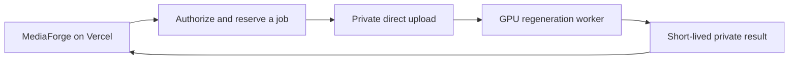

# Invisible SynthID: hosted processing preparation

> Historical hosted alternatives. The selected 0.3.0 path is the [local NVIDIA companion](invisible-watermarks-local.md), with an opt-in web/desktop connection. No hosted GPU resources or paid accounts were provisioned.

8 November 2026. **Status: preparation only; no cloud resources, accounts, paid plans or GPU jobs created.** The live Vercel app and published Android 0.2.0 remain unchanged. Invisible removal is not enabled in the app.

**Direction updated:** the owner chose local computer GPUs and identified a Windows RTX 3050 with 4 GB VRAM. Use the [local GPU check and trial guide](invisible-watermarks-local.md) first. The hosted choices below remain an alternative only; provisioning and spend are not authorized by this plan.

## Keep Vercel

MediaForge can stay at its existing Vercel address. Vercel explicitly separates its application layer from GPU inference; it does not provide native GPU execution for this workload. [Official explanation](https://vercel.com/i/what-is-serverless-gpu).

The hosted alternative would use a short Vercel job/control API plus a separate protected GPU worker. Images larger than Vercel's 4.5 MB function request limit need direct private uploads rather than passing the file through a normal route. [Current payload limit](https://vercel.com/docs/functions/limitations#request-body-size). Large functions and longer timeouts do not create a CUDA GPU.

This is a proposed integration, not a deployed architecture. The first trial should be owner-only. The current public app has no user accounts or paid-compute quotas; placing an owner GPU key behind an unrestricted public route would allow anyone to consume its budget. Public availability requires an explicit access/quota policy first.

## Hosted choices

USD list prices checked on 8 November 2026. Hourly figures express allocated compute time, not an always-on monthly commitment. Account eligibility, availability and regional pricing require confirmation before purchase.

| Choice | GPU class | Published compute rate | Fit for MediaForge |
| --- | --- | --- | --- |
| Modal Functions | L4, 24 GB | $0.000222/second = $0.7992/hour | Recommended first benchmark: Python worker and scale-to-zero operation |
| Modal Functions | L40S, 48 GB | $0.000542/second = $1.9512/hour | Explicitly approved fallback if a 24 GB trial does not fit |
| Runpod Serverless Flex | L4/A5000/3090 class, 24 GB | $0.75/hour, metered by the second | Alternative with containerized, queued inference |
| Runpod Serverless Flex | L40/L40S/6000 Ada class, 48 GB | $1.75/hour, metered by the second | More GPU memory; requires a container/handler integration |

Sources: [Modal pricing](https://modal.com/pricing), [Runpod pricing](https://www.runpod.io/pricing), [Runpod billing mechanics](https://docs.runpod.io/serverless/pricing). Modal also bills CPU and host RAM; Runpod adds storage. Both can bill cold loading and idle tails. These figures are **not a measured per-image quote**. No GPU-fit, latency or removal benchmark has run here.

For illustration only, an allocated Modal L4 with 2 physical CPU cores and 64 GiB RAM costs about $0.00039028/second at the listed rates: about $0.0234 for 60 seconds or $0.0703 for 180 seconds, excluding storage, network, any regional multiplier and startup/idle time beyond that interval. An image might take more or less time. Measure a full cold start and a warm job before estimating production costs.

Modal currently advertises a Starter compute allowance, but that is not a guarantee of free operation. Workspace usage budgets and out-of-pocket spend limits are separate controls. [Official budget behavior](https://modal.com/docs/guide/budgets). Do not activate a trial until account access, allowed credit use and the exact spending ceiling are approved. No automatic upgrade to a larger GPU is proposed.

## Prepared code

The [optional GPU adapter](../services/invisible-watermarks/README.md) is implemented separately from Next/Electron/Android. It calls the published `remove-ai-watermarks` 0.54.1 CLI using the Google cohort and SDXL-ZImage regeneration profile, with seed 0, a 1536-pixel cap and CPU offload. It does not contain a local SynthID detector. The alternative spectral project has a research/non-commercial license and was not bundled.

The adapter preserves originals, rejects existing/racing output destinations, bounds input size/pixels, validates actual images, rejects engine passthroughs, cleans temporary files and never labels an output SynthID-free. Twenty local diagnostic, batch, preflight and file-safety tests pass using simulated hardware/engine outputs. That establishes local handling only; it is not a removal result. Local preflight correctly reports unavailable: AMD graphics, no NVIDIA CUDA device or installed processing engine.

The upstream engine's runtime/model dependencies must be installed and locked in an isolated, reviewed GPU image. Model licenses remain separate. No model, library code or signing credential is copied into MediaForge's shipped packages. [Upstream pinned source and limits](https://github.com/wiltodelta/remove-ai-watermarks/tree/3168d878461eed072bf86c237b219611261cf85f), [published package](https://pypi.org/project/remove-ai-watermarks/0.54.1/).

## Activation requirements

1. Approve a provider account, an explicit out-of-pocket limit and any use of credits. Keep minimum workers at zero, maximum at one, one job at a time, no automatic retries, a processing timeout and a short idle tail. Keep the pilot private; stop rather than silently switching to a more expensive GPU.
2. Review/cache the exact models and lock the full environment; measure disk use, peak GPU/RAM use, cold/warm runtime and complete billable cost. CPU offload can reduce GPU pressure but is not proof that the profile fits a given card.
3. Use non-sensitive, known-positive Gemini/Imagen originals, plus clean controls. Check each original and result with Google's official SynthID detector. Record hashes, model version, seed, dimensions, detector responses and date. A negative detector response is an observation, not proof against all future detectors.
4. Review faces, small text, fine detail and colors. The method regenerates pixels and can change them; metadata removal, compression or a low AI-classifier score alone is not SynthID-removal verification. [Official SynthID behavior and detector entry](https://deepmind.google/models/synthid/).
5. Then add the public app flow: clear upload consent, authenticated/quota-bound jobs, server-only provider credentials, direct private uploads, signed result URLs, deletion on completion/cancel/failure and a short retention deadline (proposed 15 minutes). Allow only trusted storage locations at the worker; do not accept arbitrary fetch URLs. Persist model weights separately from user files.
6. Test actual deployed submit/poll/download/cancel/retry/expiry flows and mobile access. Only publish new web/Android capabilities after that end-to-end check. Published 0.2.0 binaries/tags must not be overwritten.

The selected next step is the owner's local RTX 3050 compatibility check and a real model/detector trial. A hosted trial would separately require provider/account/budget authorization. Deployment, account creation, image uploads to a hosted worker and paid execution have not been performed.
